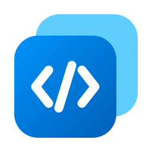

# \<Multi\>Dex

[](https://github.com/MultiDex/MultiDex/actions/workflows/build.yml)

Bộ công cụ nhỏ hằng ngày của developer — format JSON, giải mã JWT, Base64, hash, cron, regex, UUID… — gom trong một app desktop chạy hoàn toàn offline. Giao diện theo Fluent 2 / Windows 11, dựng bằng Tauri 2 + React + TypeScript.

> **Trạng thái: prototype giao diện.** Mọi công cụ đang hiển thị dữ liệu mẫu cố định. Chưa có logic xử lý thật và chưa có Rust command nào.

## Tính năng

- **9 công cụ mẫu** trong 4 danh mục:

  | Danh mục            | Công cụ                               |
  | ------------------- | ------------------------------------- |
  | Converters          | Color Converter, Cron Parser          |
  | Encoders / Decoders | Base64 Text, JWT Decoder, URL Encoder |
  | Text                | JSON Formatter, Regex Tester          |
  | Generators          | Hash Generator, UUID Generator        |

- **Trang chủ**: Gần đây, Đã ghim, Tất cả; tìm công cụ theo tên, bí danh (`b64`, `jwt`, `cron`…) hoặc mô tả.
- **Trang công cụ**: chế độ (Segmented), nhóm cấu hình (SettingsCard), InfoBar, khung Input/Output có tô màu cú pháp, nút sao chép kèm toast.
- **Giao diện Sáng / Tối / theo hệ thống**, áp dụng trước lần vẽ đầu nên không bị nháy.
- **Thanh điều hướng 3 chế độ** theo bề rộng cửa sổ: mở (≥ 1008px), chỉ icon (641–1007px), ẩn và mở dạng overlay (≤ 640px).
- **Thanh tiêu đề tự vẽ**: kéo cửa sổ, double-click để phóng to, nút thu nhỏ / phóng to / đóng.

### Phím tắt

| Thao tác                     | Phím           |
| ---------------------------- | -------------- |
| Tìm công cụ                  | `Ctrl+K`       |
| Mở kết quả tìm kiếm đầu tiên | `Enter`        |
| Xoá ô tìm kiếm               | `Esc`          |
| Mở/đóng thanh điều hướng     | `Ctrl+B`       |
| Đổi giao diện Sáng ↔ Tối     | `Ctrl+Shift+L` |
| Quay lại                     | `Alt+←`        |

## Tải về

Tải bản mới nhất ở trang [Releases](https://github.com/MultiDex/MultiDex/releases/latest). Mỗi lần push lên `main` tạo một release mới tên `v<phiên bản>-build.<số>`, gồm:

- `MultiDex_<phiên bản>_x64-portable.exe` — chạy ngay, không cần cài.
- `MultiDex_<phiên bản>_x64-setup.exe` — bộ cài, có shortcut Start menu và mục gỡ cài đặt.

Pull request vào `main` cũng được build nhưng không tạo release; file nằm ở mục **Artifacts** của lần chạy trong tab [Actions](https://github.com/MultiDex/MultiDex/actions/workflows/build.yml).

Ghi chú:

- File chưa được ký số, nên lần đầu mở Windows SmartScreen sẽ cảnh báo. Chọn **More info → Run anyway**.
- Cần Microsoft Edge WebView2 Runtime. Windows 11 có sẵn; bộ cài tự tải về trên Windows 10 nếu thiếu.

## Phát triển

### Yêu cầu

- [Node.js](https://nodejs.org/) 24
- [Rust](https://rustup.rs/) stable (≥ 1.85, vì crate dùng edition 2024)
- Windows: Visual Studio hoặc Build Tools với workload **Desktop development with C++**, và WebView2
- macOS / Linux: xem [Tauri prerequisites](https://tauri.app/start/prerequisites/)

### Lệnh

```sh
npm install
```

| Lệnh                   | Việc làm                                                    |
| ---------------------- | ----------------------------------------------------------- |
| `npm run dev`          | Chạy giao diện trên trình duyệt tại `http://localhost:1420` |
| `npm run tauri dev`    | Chạy app trong cửa sổ desktop, tự tải lại khi sửa code      |
| `npm run tauri build`  | Build bản phát hành (exe + bộ cài)                          |
| `npm test`             | Chạy test (`node --test`)                                   |
| `npm run format`       | Format code bằng Prettier                                   |
| `npm run format:check` | Kiểm tra format, không sửa file                             |

Lần đầu `npm run tauri dev` hoặc `npm run tauri build` mất vài phút để biên dịch Rust; các lần sau nhanh hơn nhiều.

### Kết quả build

| File                                                        | Dùng để     |
| ----------------------------------------------------------- | ----------- |
| `src-tauri/target/release/multidex.exe`                     | Chạy ngay   |
| `src-tauri/target/release/bundle/nsis/MultiDex_*-setup.exe` | Bộ cài NSIS |
| `src-tauri/target/release/bundle/msi/MultiDex_*.msi`        | Bộ cài MSI  |

## Cấu trúc thư mục

```text
.
├── .github/workflows/build.yml   CI: test, build bản Windows, tạo release khi push lên main
├── index.html                    Script đặt theme trước lần vẽ đầu
├── src/
│   ├── App.tsx                   Khung app: điều hướng theo hash, phím tắt, theme, toast
│   ├── components/               TitleBar, Sidebar, ToolCard, CodePanel, SettingRow
│   ├── pages/                    Home, ToolPage, Settings
│   ├── data/tools.ts             Danh sách công cụ và dữ liệu mẫu
│   ├── lib/                      theme.ts (Sáng/Tối/Hệ thống), highlight.ts (tô màu JSON)
│   └── styles/                   tokens.css, bundle.css, app.css
├── src-tauri/                    Khung Tauri: tauri.conf.json, capabilities/, src/
└── tests/                        Test chạy bằng node --test
```

## Giao diện

- `src/styles/tokens.css` — token màu, khoảng cách, bo góc, bóng theo tên theme resource của WinUI (`text-primary`, `fill-accent-default`, `bg-card`…). Theme đổi bằng thuộc tính `data-theme` trên `<html>`.
- `src/styles/bundle.css` — style component, lớp có tiền tố `dx-`.
- `src/styles/app.css` — phần bố cục riêng của app.
- Mọi màu đều lấy từ token, không viết mã màu cứng, để cả hai theme luôn đúng.
- Font: Segoe UI Variable (có sẵn trên Windows, không đóng gói) và Cascadia Mono (đóng gói). Icon: Fluent System Icons.
- Logo app: nguồn là `src-tauri/icons/icon.svg`, `public/favicon.svg` là bản sao dùng cho tab trình duyệt. Sửa logo xong thì chạy `npx tauri icon src-tauri/icons/icon.svg` để sinh lại các file `.ico`, `.icns`, `.png`, rồi xoá thư mục `android/` và `ios/` lệnh này tạo thêm. Cargo không tự build lại khi chỉ có icon đổi, nên trước lần build kế tiếp chạy `cargo clean --manifest-path src-tauri/Cargo.toml -p multidex` để exe nhận icon mới.

## Hạn chế đã biết

- Công cụ chỉ hiển thị dữ liệu mẫu; tuỳ chọn và nút hành động chưa làm thay đổi kết quả.
- Chưa có hiệu ứng nền Mica, Snap Layouts và màu nhấn theo Windows (cả ba cần code Rust).
- ToolTip đang dùng thuộc tính `title` của trình duyệt.

## Giấy phép bên thứ ba

- [Cascadia Mono](https://github.com/microsoft/cascadia-code) — SIL Open Font License 1.1
- [Fluent System Icons](https://github.com/microsoft/fluentui-system-icons) — MIT
- [Tauri](https://tauri.app/) — MIT / Apache-2.0
